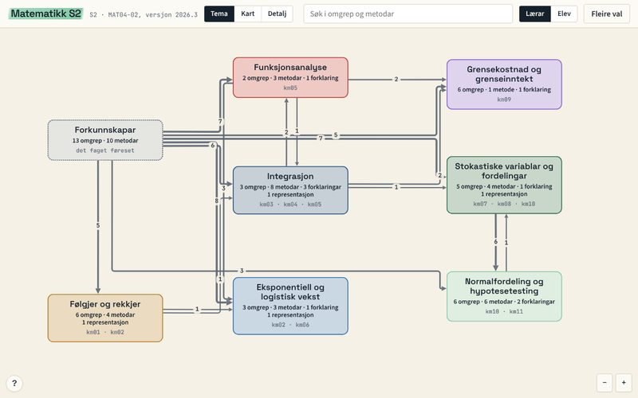
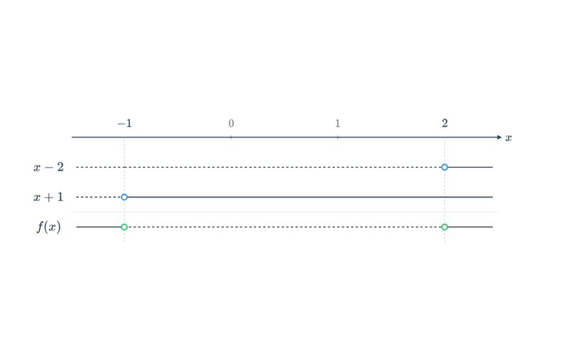
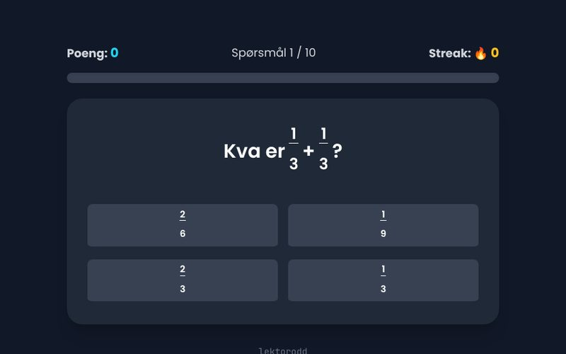
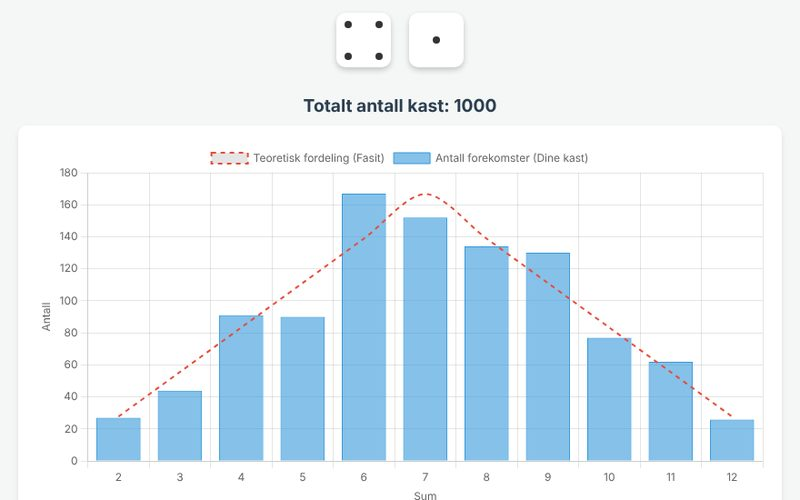
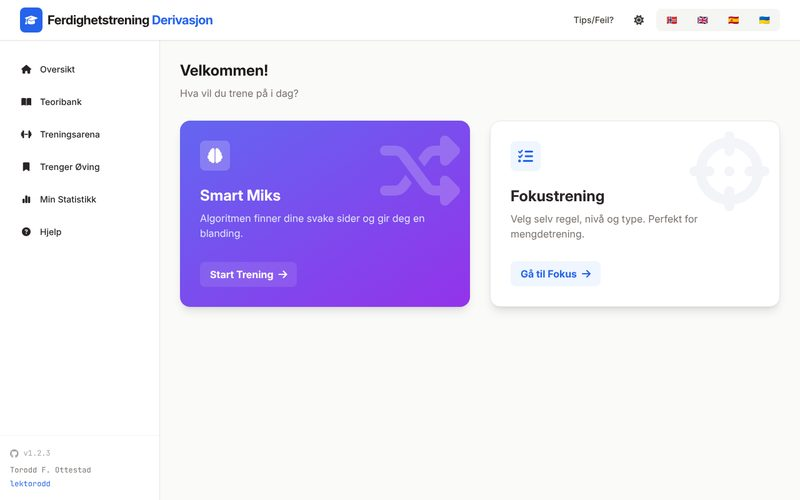
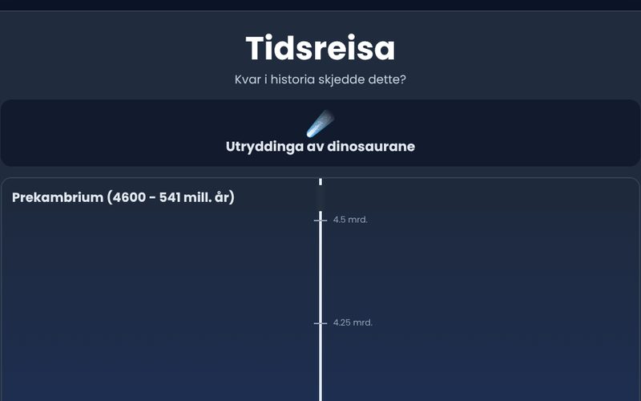
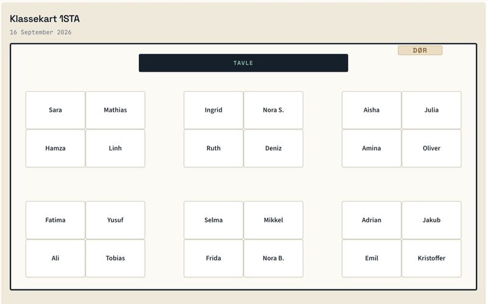
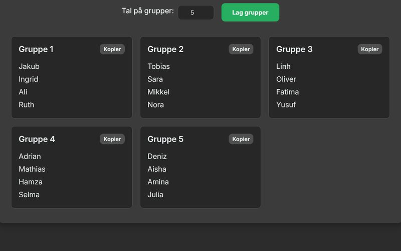
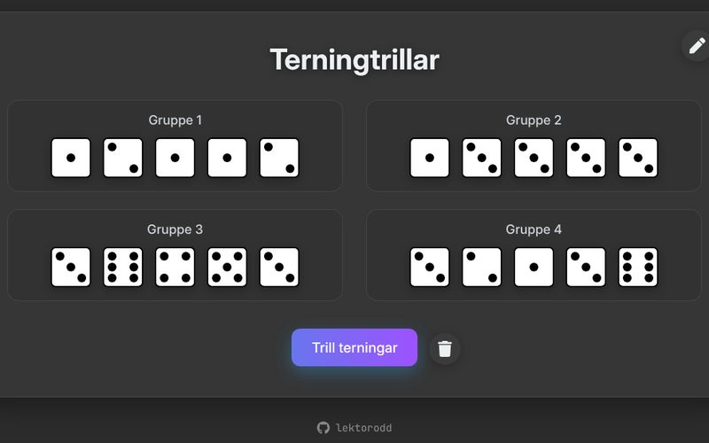

<!--
Legg til ein app: kopier ein <a class="lo-app">-blokk og endra href, bilete, tittel, tekst og adresse.
Bileta ligg i appar/bilete/ og er 800 x 500 px (16:10). Manglar biletet, viser kortet namnet på ei flate.
Appane ligg på one.com utanfor Quarto, så adressene må peike dit dei faktisk ligg.
-->

## Matematikk

```{=html}
<div class="lo-appar t-stat">
  <a class="lo-app" href="https://fagkart.lektorodd.no/s2/">
    <span class="lo-app-bilete" data-namn="Fagkart"></span>
    <span class="lo-app-innhald">
      <span class="lo-app-tittel">Fagkart</span>
      <span class="lo-app-tekst">Sjå korleis S2 heng saman, kva du bør kunne frå før, og marker sjølv kva du kan.</span>
      <span class="lo-app-adresse">fagkart.lektorodd.no</span>
    </span>
  </a>
  <a class="lo-app" href="/forteiknslinjer.html">
    <span class="lo-app-bilete" data-namn="Forteiknsskjema"></span>
    <span class="lo-app-innhald">
      <span class="lo-app-tittel">Forteiknsskjema</span>
      <span class="lo-app-tekst">Lag forteiknslinjer for faktoriserte uttrykk og brøkar.</span>
      <span class="lo-app-adresse">lektorodd.no/forteiknslinjer.html</span>
    </span>
  </a>
  <a class="lo-app" href="/brok.html">
    <span class="lo-app-bilete" data-namn="Brøk-meister"></span>
    <span class="lo-app-innhald">
      <span class="lo-app-tittel">Brøk-meister</span>
      <span class="lo-app-tekst">Kjapp trening i brøkrekning, ti oppgåver med aukande vanskegrad.</span>
      <span class="lo-app-adresse">lektorodd.no/brok.html</span>
    </span>
  </a>
  <a class="lo-app" href="/store_tall.html">
    <span class="lo-app-bilete" data-namn="Store tals lov"></span>
    <span class="lo-app-innhald">
      <span class="lo-app-tittel">Store tals lov</span>
      <span class="lo-app-tekst">Simuler myntkast og terningkast og sjå den relative frekvensen stabilisere seg.</span>
      <span class="lo-app-adresse">lektorodd.no/store_tall.html</span>
    </span>
  </a>
  <a class="lo-app" href="/derivasjon/">
    <span class="lo-app-bilete" data-namn="Derivasjonstrening"></span>
    <span class="lo-app-innhald">
      <span class="lo-app-tittel">Derivasjonstrening</span>
      <span class="lo-app-tekst">Øv på derivasjonsreglane med oppgåver som tilpassar seg nivået ditt.</span>
      <span class="lo-app-adresse">lektorodd.no/derivasjon/</span>
    </span>
  </a>
</div>
```

## Geofag

```{=html}
<div class="lo-appar t-kart">
  <a class="lo-app" href="/geotid.html">
    <span class="lo-app-bilete" data-namn="Tidsreisa"></span>
    <span class="lo-app-innhald">
      <span class="lo-app-tittel">Tidsreisa</span>
      <span class="lo-app-tekst">Plasser hendingar på den geologiske tidslinja.</span>
      <span class="lo-app-adresse">lektorodd.no/geotid.html</span>
    </span>
  </a>
  <a class="lo-app" href="/geofag-standpunkt/">
    <span class="lo-app-bilete" data-namn="Kjenneteikn på standpunkt"></span>
    <span class="lo-app-innhald">
      <span class="lo-app-tittel">Kjenneteikn på standpunkt</span>
      <span class="lo-app-tekst">Kjenneteikn på måloppnåing i geofag.</span>
      <span class="lo-app-adresse">lektorodd.no/geofag-standpunkt/</span>
    </span>
  </a>
</div>
```

## Til læraren

```{=html}
<div class="lo-appar t-kode">
  <a class="lo-app" href="https://klassekart.lektorodd.no">
    <span class="lo-app-bilete" data-namn="Klassekart"></span>
    <span class="lo-app-innhald">
      <span class="lo-app-tittel">Klassekart</span>
      <span class="lo-app-tekst">Trekk klassekart frå ei klasseliste, med sitjereglar og eige romoppsett.</span>
      <span class="lo-app-adresse">klassekart.lektorodd.no</span>
    </span>
  </a>
  <a class="lo-app" href="https://provesplitt.lektorodd.no">
    <span class="lo-app-bilete" data-namn="Prøvesplitt"></span>
    <span class="lo-app-innhald">
      <span class="lo-app-tittel">Prøvesplitt</span>
      <span class="lo-app-tekst">Lag skiljeark, skann prøvane og få ei PDF-fil med namn til kvar elev. Alt skjer på di eiga maskin.</span>
      <span class="lo-app-adresse">provesplitt.lektorodd.no</span>
    </span>
  </a>
  <a class="lo-app" href="/grupper.html">
    <span class="lo-app-bilete" data-namn="Gruppegenerator"></span>
    <span class="lo-app-innhald">
      <span class="lo-app-tittel">Gruppegenerator</span>
      <span class="lo-app-tekst">Lag tilfeldige grupper frå ei namneliste eller frå Visma InSchool.</span>
      <span class="lo-app-adresse">lektorodd.no/grupper.html</span>
    </span>
  </a>
  <a class="lo-app" href="/terning.html">
    <span class="lo-app-bilete" data-namn="Terningtrillar"></span>
    <span class="lo-app-innhald">
      <span class="lo-app-tittel">Terningtrillar</span>
      <span class="lo-app-tekst">Trill terningar på tavla når de treng tilfeldige tal.</span>
      <span class="lo-app-adresse">lektorodd.no/terning.html</span>
    </span>
  </a>
</div>
```

Kjeldekoden ligg på [GitHub](https://github.com/lektorodd).
