:::: {.content-hidden unless-format="html"}
# Løysingsforslag 2P-Y - hausten 2025

Her er eit forslag til løysing av hausteksamen i 2P-Y 2025. Eg kan ikkje lova at løysinga er feilfri. Gje meg gjerne ein lyd i kommentarfeltet eller [her](/about.qmd) om du ser feil :mag:

------------------------------------------------------------------------

Eksamenssettet finn du hos UDIR: [Finn eksamensoppgaver](https://sokeresultat.udir.no/eksamensoppgaver.html)

::: callout-tip
## Tips

I menyen til høgre finn du løysingsforslaget som pdf!
:::
::::

# Del 1 - utan hjelpemiddel

## Oppgåve 1

$$
\begin{align*}
\text{ny pris} &= \text{gammal pris} \cdot \text{vekstfaktor} \\
\text{vekstfaktor} &= \frac{\text{ny pris}}{\text{gammal pris}} \\
&= \frac{315}{300} \\
&= 1.05
\end{align*}
$$

Vekstfaktoren er $1.05$, som vil seie at prisen har auka med $5 \%$.

## Oppgåve 2  

Rundar av prisen til 500 kr. Dermed får me

$$10\cdot 40000 \cdot 500 = 200000000 = 2 \cdot 10^8$$

Studentane betalar om lag $2 \cdot 10^8$ kr for kollektivtransport i året.

## Oppgåve 3

$$\sqrt{2} \quad 0,02 \cdot 10^2 \quad 3^2 \quad 2^0 \quad \sqrt{80} \quad 3 \cdot 10^{-1} \quad 4^{-1}$$

| Uttrykk           | Utrekning/tankar     |
|-------------------|----------------------|
| $\sqrt{2}$        | mellom 1 og 2        |
| $0.02 \cdot 10^2$ | $0.02 \cdot 100 = 2$ |
| $3^2$             | $9$                  |
| $2^0$             | $1$                  |
| $\sqrt{80}$       | mellom 8 og 9        |
| $3 \cdot 10^{-1}$ | $3 \cdot 0.1 = 0.3$  |
| $4^{-1}$          | $\frac{1}{4} = 0.25$ |

Rangert frå minst til størst: $$4^{-1} \quad 3 \cdot 10^{-1} \quad 2^0 \quad \sqrt{2} \quad 0,02 \cdot 10^2 \quad \sqrt{80} \quad 3^2$$

## Oppgåve 4

### a) tomme vogner

Det er $2+3+4+6=15$ vogner med passasjerar i frekvenstabellen og totalt $20$ vogner.

Det er då $20 - 15 = 5$ tomme vogner.

### b) sentralmål

#### Gjennomsnitt

| personar | frekvens | produkt |
|----------|----------|---------|
| 0        | 5        | 0       |
| 1        | 2        | 2       |
| 2        | 3        | 6       |
| 3        | 4        | 12      |
| 4        | 6        | 24      |
| **Sum**  | **20**   | **44**  |

Gjennomsnittleg antal personar per vogn er då 2.2 personar

$$\frac{44}{20} = 2.2$$

#### Median

Det er 20 vogner, så medianen er gjennomsnittet av den 10. og 11. observasjonen. Legg til ei rad med kumulativ frekvens:

| personar | frekvens | kumulativ frekvens |
|----------|----------|--------------------|
| 0        | 5        | 5                  |
| 1        | 2        | 7                  |
| 2        | 3        | 10                 |
| 3        | 4        | 14                 |
| 4        | 6        | 20                 |

Her ser me at vogn nummer 10 har 2 personar, og vogn nummer 11 har 3 personar.

Medianen er då 2.5 personar

$$\frac{2 + 3}{2} = 2.5$$

### c) kumulativ frekvens

Av tabellen over ser me at den kumulative frekvensen for 2 personar er 10. Det vil seie at 10 av 20 vogner har 2 eller færre personar ombord.

## Oppgåve 5

### a) proporsjonale storleikar

To storleikar $x$ og $y$ er proporsjonale storleikar dersom det er slik at $\frac{y}{x} = k$. Det vil seie at om $x=0$ så er også $y=0$. Det er berre graf `q` som tilfredsstiller dette.

Ser at når $x=8$ så er $y=1200$. Dermed er konstanten $k$ gitt ved:

$$k = \frac{y}{x} = \frac{1200}{8} = 150$$

og $q = 150x$.

Graf $q = 150x$ viser proporsjonale storleikar.

### b) omvendt proporsjonale storleikar

To storleikar $x$ og $y$ er omvendt proporsjonale storleikar dersom det er slik at $x \cdot y = k$. Det vil seie at når $x$ vert dobla så vert $y$ halvert. Både graf `r` og `s` minkar når $x$ aukar. Ser me på graf `r` ser me at når $x$ vert dobla så vert $y$ halvert. (feks frå 1200 til 600 når $x$ går frå 1 til 2). Dermed er konstanten $k$ gitt ved:

$$k = x \cdot y = 1 \cdot 1200 = 1200$$

og $r = \frac{1200}{x}$.

Graf $r = \frac{1200}{x}$ viser omvendt proporsjonale storleikar.

## Oppgåve 6

### a) Figur 4 og 10

Ser at for kvar auke i figurtal vert det lagt til ein ny trekant (med to nye pinnar).

| figurtal | antal pinnar |
|----------|------------------|
| 1        | 3                |
| 2        | 5                |
| 3        | 7                |

For figur 4 vert det lagt til ein ny trekant frå figur 3 med 2 pinnar, så det trengst $7 + 2 = 9$ pinnar.

Frå figur 4 til figur 10 vert det lagt til 6 nye trekanter, så det trengst $9 + 6 \cdot 2 = 21$ pinnar.

### b) Figur n
 
| figurtal | antal pinnar |
|----------|------------------|
| 1        | $3 = 3 + 0 \cdot 2 = 3 + (1-1) \cdot 2$                |
| 2        | $3+2 = 3 + 1 \cdot 2 = 3 + (2-1) \cdot 2$              |
| 3        | $3+2+2 = 3 + 2 \cdot 2 = 3 + (3-1) \cdot 2$               |
| 4        | $3+2+2+2 = 3 + 3 \cdot 2 = 3 + (4-1) \cdot 2$               |
| $n$        | $3 + (n-1) \cdot 2$               |

Her ser me at $3 + (n-1)\cdot 2 = 3+2n - 2 = 2n + 1$ er ein fin formel for antal pinnar i figur $n$.

### c) Programkode

I koden er det definert variablar for figurnummer, totalt antal pinnar, pinnar i aktuell figur og ei grense på 1000 pinnar.

I rad 7-10 vert det rekna ut totalt antal pinnar brukt for figurar frå 1 til figurnummer. Første gong gjennom løkka er for figur 1 (`n=n+1`og `n=0` innleiingsvis). Vidare vert det lagt til 2 pinnar i figuren (slik at figur 2 har 3+2 pinnar). Koden held på så lenge totalt antal pinnar er mindre enn 1000.

Koden skriv ut 31 og 1023 (som me les av koden er `n` og `total`). 
Det vil seie at me kan laga dei 30 første figurane utan å gå over 1000 pinnar, og at totalt antal pinnar brukt for dei 31 første figurane er 1023 pinnar.

# Del 2 - med hjelpemiddel

## Oppgåve 1

Bruker GeoGebra for å laga modellen. Sidan $x$ er månader etter februar 2025, let me $x=0$ vere februar 2025.

### a) eksponentiell modell

Legg inn verdiane i reknearket i GeoGebra, lagar punktliste og bruker denne inn i regresjonskommandoen for å finna ein eksponentiell modell.

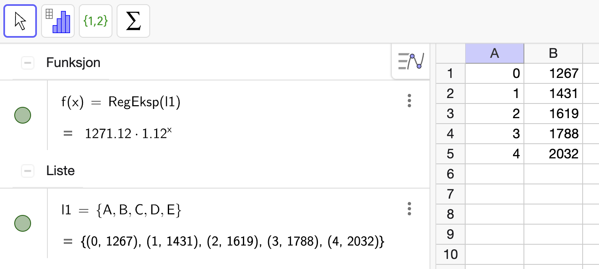{width=80%}

Modellen me får er: $$f(x)=1271\cdot 1.12^x$$

### b) Prosentvis endring

I funksjonsuttrykket er $1.12$ vekstfaktoren. Prosentvis endring er då:
$$(1.12 - 1) \cdot 100\% = 12\%$$

### c) Nå 20 000 kr i månaden

Løys likninga $$1271 \cdot 1.12^x = 20000$$ i GeoGebra:

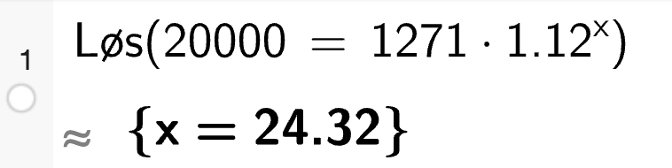{width=50%}

Det tek i følge modellen omlag 24 månader frå februar 2025, altså i februar 2027.

### d) Prosentvis auke i 2025

Skal han nå målet om 20 000 kr i månaden innan utgangen av 2025, må han auke inntekta frå 2032 kr i juni til 20000 kr i desember. Det er 6 månader. Løys likninga $$2032 \cdot a^6 = 20000$$ i GeoGebra:

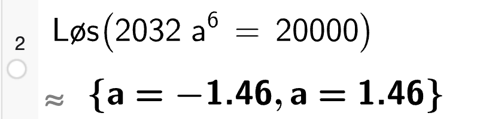{width=50%}

Ser at $a \approx 1.46$. Dermed må den prosentvise auken vera på omlag $46 \%$ per månad.

## Oppgåve 2

### a) Innbyggjarar i byar i Noreg

Reknar ut måla i GeoGebra:

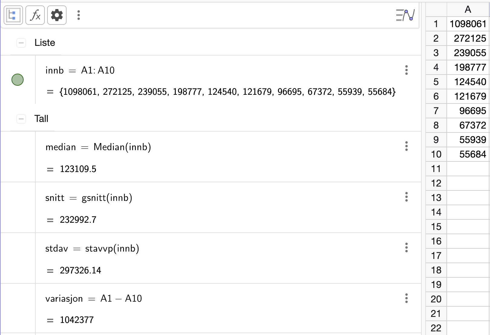{width=100%}

- Medianen er 123 110 innbyggjarar.
- Gjennomsnittet er 232 993 innbyggjarar.
- Standardavviket er 297 326 innbyggjarar.
- Variasjonsbreidda er 1 042 377 innbyggjarar.

### b) Kva mål er best?

Me ser at Oslo har omlag 4 gangar så mange innbyggjarar som Bergen, som er den nest største byen. Dette gjer at gjennomsnittet vert trekt mykje opp av Oslo, og at `medianen` vert eit betre mål for den "typiske" bystorleiken i Noreg. Kine har rett.

### c) Samanlikna med Danmark

Gjennomsnittet er ganske likt som i Noreg. 

I Noreg bur det omlag $232 993 \cdot 10 = 2 329 930$ innbyggjarar i dei 10 største byane, medan det i Danmark bur omlag $235 549 \cdot 10 = 2 355 490$ innbyggjarar i dei 10 største byane.

At medianen i Danmark er mykje lågare enn i Noreg (67 832 vs 123 110) tyder på at det er fleire mindre byar på topp 10-lista i Danmark enn i Noreg, sidan midtpunktet på den danske lista ligg mellom by nummer 7 og 8 på den norske lista. København og Aarhus begge store byar som trekk opp snittet. 

Standardavviket som er på 388 000 i danmark understøtter dette, sidan det tyder på at det er stor variasjon i bystorleikane i Danmark samanlikna med Noreg.

## Oppgåve 3

Startar med å laga eit diagram i Excel som viser utviklinga i dei ulike aldersgruppene samla:

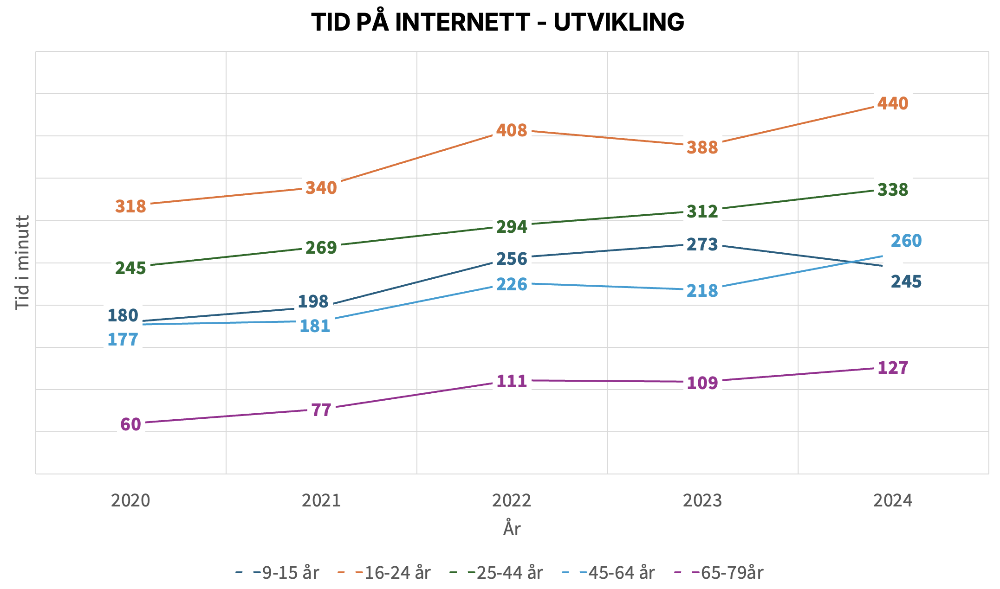

Her kan me sjå at nettbruken aukar i alle aldersgrupper i perioden totalt sett. Litt interessant at det var nedgang i aldersgruppa 9-15 år frå 2023 til 2024. Også interessant at det samme skjedde med aldersgruppa 16-24 år frå 2022 til 2023, før det auka att i 2024. 

I 2024 har også dei mellom 45-65 år for første gong høgare nettbruk enn dei på 9-15 år.

Ser vidare på korleis aldersgruppene fordeler seg i 2020 vs 2025 (litt det samme som i 1, men viser tydelegare fordelinga):

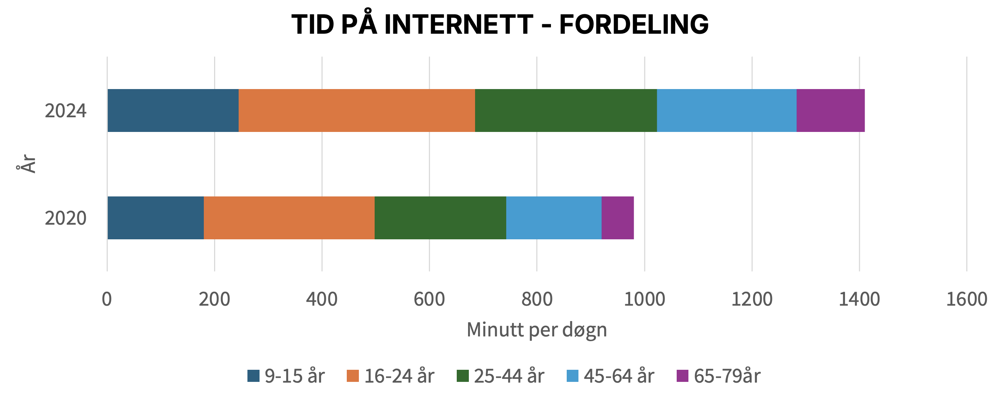

Her ser me og at den samla internettbruken har auka mykje (gitt at det er omlag same tal personar i kvar aldersgruppe i 2020 og 2025). Dette trass i at 2020 og 2021 var år prega av koronapandemien, der både barn og unge hadde mykje heimeundervisning og vaksne jobba heimefrå. Det er ikkje teikn til at internettbruken har gått ned att etter pandemien.

Gjer utrekning i prosentvis endring per aldersgruppe frå 2020 til 2025 i Excel:

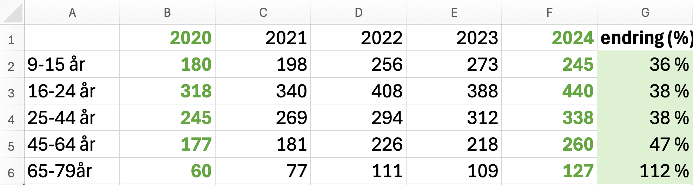{width=80%, fig-align="center"}

Her ser me at det relativt er dei eldste (65-79 år) som har hatt den heilt klart største auken i internettbruk i perioden. Heile 112 % samanlikna med rundt 40 % for dei andre aldersgruppene. 

Med tilhøyrande formlar: 

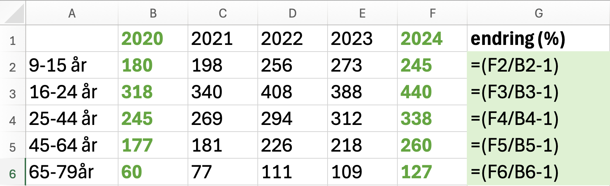

Me kan og rekna ut kor stor del av døgeret ungdom på 16-24 år brukar på internett i 2024:

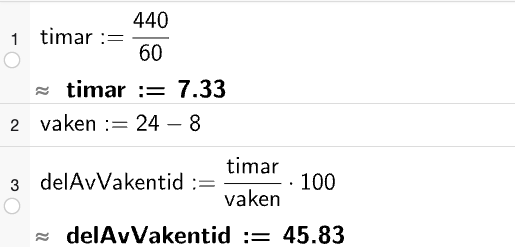{width=80%, fig-align="center"}

Her ser me at ungdom i aldersgruppa 16-24 år, som er dei som brukar klart mest internett, brukar omlag 46% av den vakne tida si (gitt at dei søv 8 timar per døgn) på internett i 2024.

### Oppsummering

Me ser at internettbruken har auka i alle aldersgrupper frå 2020 til 2025. 

Den største auken i prosent er i aldersgruppa 65-79 år, der auken er på 112 %. Kanskje kan dette henga saman med sosiale medium (kontakt med slekt etter pandemien), digitalisering av tenester i samfunnet eller andre ting. 

Samstundes ser me at frå 2023 til 2024 har dei yngste (9-15 år) hatt ein liten nedgang i internettbruk og blitt tatt igjen av aldersgruppa 45-64 år. Kanskje kan denne nedgangen henga saman med auka fokus på skjermtid for barn og unge og teknologibruk i barneskulen? 

## Oppgåve 4

Løsyer i CAS:

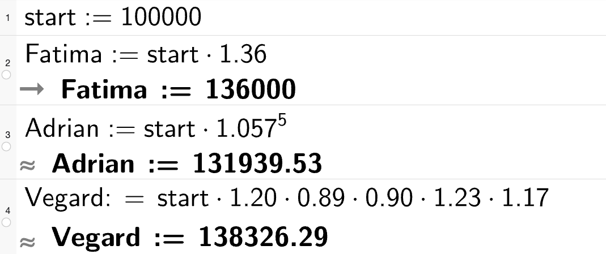{width=60%}

I starten av 2025 hadde dei omlag dette på konto:

- **Vegard** 138 326 kr
- **Fatima** 136 000 kr
- **Adrian** 131 940 kr

## Oppgåve 5

### a) Føresetnader

For å rekna ut sentralmål frå tabellen må me gå ut frå at personane er jamt fordelt i alder i kvar aldersgruppe. Dette gjer t.d. at me kan anta at midtpunktet i kvart aldersintervall representerer alderen til alle personane i intervallet (gjennomsnitt i intervallet).

### b) Gjennomsnittet

Bruker GeoGebra

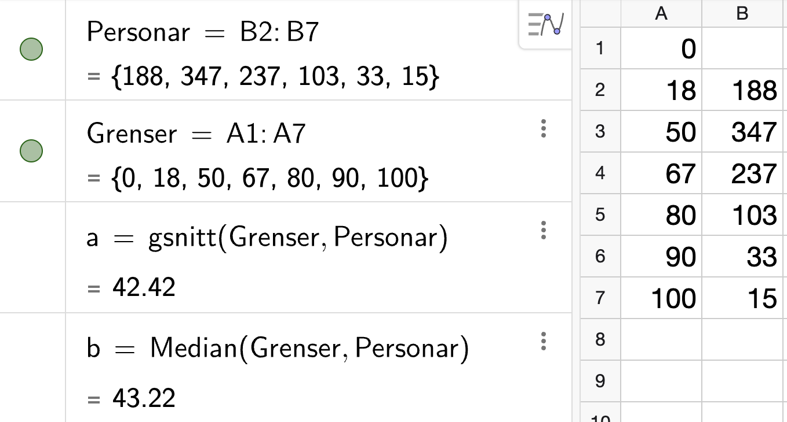{width=60%}

Ser at gjennomsnittsalderen er omlag 42,4 år. 

### c) Prosent over snittalder

::: {.callout-tip}
## Hugs

Her går me ut frå at aldersfordelinga er jamn i kvart aldersintervall. Men t.d. i den øvste aldersgruppa, 90-100 år, er det nok fleire som er nærare 90 år enn 100 år. Dette er med på å gjera utrekninga av gjennomsnittet ganske upresis, men eit ok estimat. 
:::

Brukar GeoGebra (sjå skjermbilete frå b). Ser at medianalderen er 43,2 år. Det er mindre enn eitt år som skiller medianalder og snittalder. Sidan utrekninga vår er ganske upresis (gitt føresetnadene i a) kan me seie at gjennomsnittsalderen og medianalderen er tilnærma like (jevn fordeling vil medføra at median og gjennomsnitt er ganske like). Dermed vil omlag 50% av innbyggjarane vera over gjennomsnittsalderen.

## Oppgåve 6

Julekuler og juletre. 

### Nils

> Eg trur talet på julekuler vi kjøper, og prisen vi må betale til saman for juletreet og julekulene, vil vere proporsjonale storleikar. Jo fleire kuler vi kjøper, jo meir må vi betale. Eller? 

Nils har på ein måte rett her. Talet på julekuler og prisen me må betale for julekuler er proporsjonale storleikar. Sidan det vil vere slik at om me kjøper dobbelt så mange kuler, så må me betale dobbelt så mykje for kulene. `MEN` totalen me må betale for juletreet og julekuler er ikkje proporsjonale storleikar, sidan prisen på juletreet er fast uansett kor mange kuler me kjøper. 

### Hanne

> Eg trur beløpet kvar av oss må betale, er omvendt proprosjonalt med kor mange som blir med å  dele på utgiftene. Er det rett? 

Hanne har rett, gitt at talet julekuler er fast. Dersom det er dobbelt så mange som deler på utgiftene, så må kvar av dei betale halvparten så mykje. Dermed er beløpet kvar av oss må betale omvendt proporsjonalt med kor mange som deler på utgiftene.

