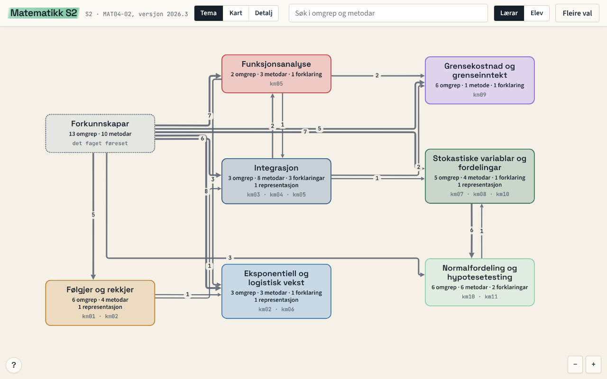
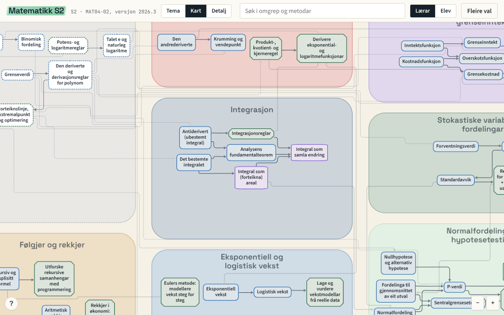
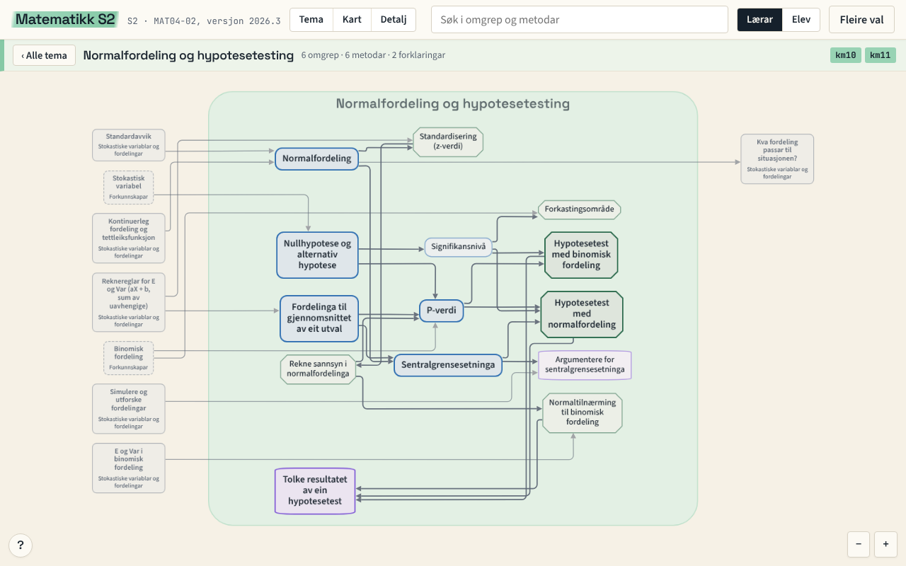
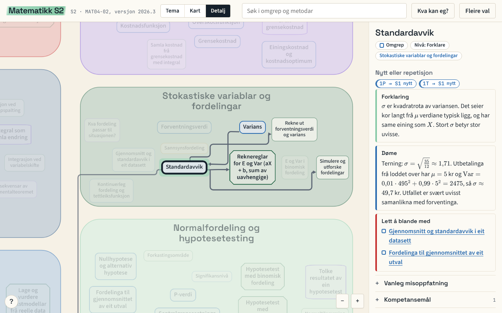
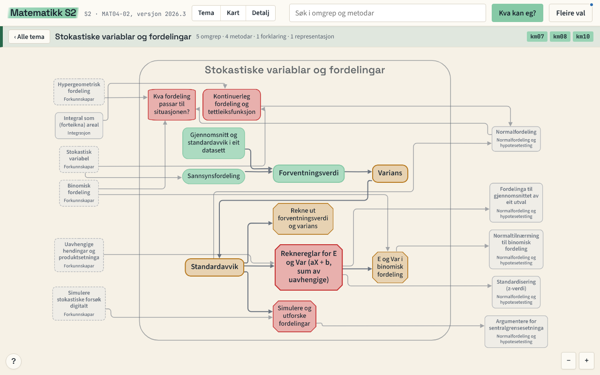
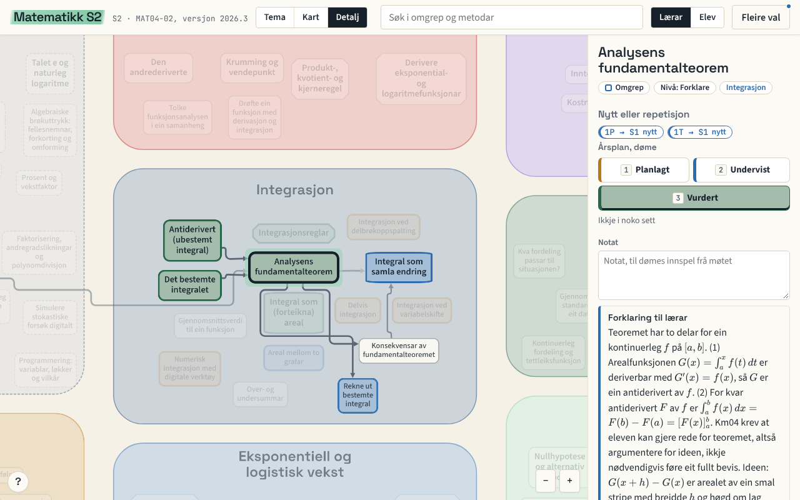

# Fagkart: sjå korleis læreplanen heng saman

Læreplanen er ofte ganske vanskelege for elevar. Og lærarar for den del. Meiningstette kulepunkt med tungvinte formuleringar. Store fag ein skal bruka timevis (ofte 140) på å dykka inn i og forstå. I framand farvatn som dette er det gjerne greitt med eit kart. Det kan gjera navigeringa noko meir overkommeleg. Viss kartet i tillegg vert knytt til forkunnskapar, viser ruter gjennom landskapet, og kan brukast til eigenvurdering! Då nærmar me oss tanken bak Fagkart. Som om ikkje det var nok, er tanken og å laga til lærarlag som kan knyttast til planlegging og t.d. vurdering. I min eigen vurderingsapp (meir om den ein annan dag) er det integrasjon med eit lokalt fagkart, der både elevane og klassen har sine eigne lag. Det første kartet er for matematikk S2, som eg underviser i år. Det finn du på [fagkart.lektorodd.no/s2/](https://fagkart.lektorodd.no/s2/).

## Kvifor fagkart

Eit fagkart er eit omgrepskart over ein læreplan. Det har kompetansemåla, omgrepa, metodane og forklaringane, og forkunnskapane faget bygger på, og linjene mellom dei. I S2 er det elleve kompetansemål, sju tema og eit eige felt for det faget legg til grunn er kjend frå før.

Utgangspunktet er enkelt. Ein elev som står fast, treng ofte ikkje meir av det same, men eit steg tilbake: kva var det eg skulle kunne før dette? Ein lærar som planlegg eit halvår, treng å sjå kva som må koma først. Begge deler står i kartet.

## Kva elevane ser

Eleven får ei eiga lenkje utan lærartekst: [fagkart.lektorodd.no/s2/?vising=elev](https://fagkart.lektorodd.no/s2/?vising=elev). Kartet er ei flate du kan zoome i. Heilt ute ser du tema som boksar, midt i ser du omgrep og metodar, og heilt nær ser du alt. Du kan byte med knappane Tema, Kart og Detalj, eller berre zoome.

Trykk på ein temaboks, så får du berre det temaet. Dei andre nodane er grå i bakgrunnen, så du ser kva som kjem utanfrå, og kva dette temaet er grunnlag for.

Trykk på ein node, så opnar kortet seg. Der står ei forklaring, eit døme, ting som er lette å blande saman med det, og kva kompetansemål det høyrer til. Kortet seier òg om stoffet er nytt eller repetisjon for den som kjem frå 1P eller 1T. Det siste er viktig i S2, for elevane har ulik bakgrunn.

### Kva kan eg?

Knappen «Kva kan eg?» er for eleven sjølv. Eleven trykkjer på eit omgrep og vel `ikkje`, `delvis` eller `heilt`. Kartet blir då teikna om i fargane til eleven: grønt for det som sit, gult for det som er delvis, raudt for det som ikkje er på plass. Då ser eleven kvar hòla ligg, og «Neste steg» viser kva hen er klar til å lære no, og kva som er svake punkt.

Det eleven markerer, blir liggjande i nettlesaren hennar. Det blir ikkje send nokon stad, og eg ser det ikkje. Eleven kan lagre ein kopi som fil og ta henne med seg. Eg har med vilje ikkje laga noko som samlar inn elevdata.

Då eg presenterte ideen for elevane første gang, var dette funksjonalitet dei kunne tenka seg vart ein del av kartet. Så då blei det det. 

## Korleis læraren brukar det

Lærarvisinga er den same flata, men med forklaringar til læraren på kortet. Der ligg òg eit lag for markering. Du kan lage ei ny markering med skalaen årsplan (planlagt, undervist, vurdert), eller lage ein eigen skala, til dømes «Repetisjon, Nytt stoff». Du merkjer nodane med tastane 1 til 6, skriv eit notat, og grupperer nodar i sett. Kartet viser så kor mange nodar under kvart kompetansemål som er dekte.

Planen er ei fil som du lagrar på maskina di. Ingenting går over nettet, og fila inneheld aldri elevdata. Skjermbiletet over er eit konstruert døme for å vise korleis det ser ut, ikkje ein plan eg har brukt.

Denne funksjonaliteten er ikkje testa på ekte enno. Så det er strengt tatt berre ein laus tanke gjort ekte. 

## Ope for alle

Alt ligg ope på [github.com/lektorodd/fagkart](https://github.com/lektorodd/fagkart). Innhaldet i karta har lisensen CC BY 4.0, og koden har MIT. Du kan bruke og endre begge, også i undervisning og kommersielt, så sant du oppgir kjelde. Læreplanteksten kjem frå Utdanningsdirektoratet og har sine eigne vilkår.

Slik kan du sitere kartet:

> Ottestad, T. F. (2026). *Matematikk S2* (versjon 2026.3). https://fagkart.lektorodd.no/s2/

Kartet er eit utkast og «work in progress». Det er laga med KI-hjelp, og det kan ha faglege feil. Eg har lagt kompetansemåla inn ordrett frå læreplanen, men forklaringar, døme og koplingar må ein faglærar lese kritisk. Fann du ein feil, [opprett eit Issue](https://github.com/lektorodd/fagkart/issues) på GitHub.

## Lag ditt eige kart

Oppskrifta er den same for andre læreplanar:

1. Lag ei mappe `kart/<KODE>/` med ei `meta.yaml` som har læreplankode, namn, versjon, kjerneelement og kompetansemål.
2. Legg læreplanteksten ordrett i `kjelder/<KODE>.md`. Eit sjekkskript passar på at kompetansemåla stemmer med kjelda.
3. Skriv ei fil per tema, med omgrep, metodar og forklaringar, og ei fil for forkunnskapane.
4. Køyr sjekken og bygget, og du får ei frittståande HTML-fil som verkar utan nett.

Heile oppskrifta, med døme, står i [`docs/LAG-EIT-KART.md`](https://github.com/lektorodd/fagkart/blob/HEAD/docs/LAG-EIT-KART.md) i repoet. Dataformatet er skrive ned i `docs/FORMAT.md`, slik at du kan bruke den verktøykjeden du vil, også ein KI-assistent. Eit kart er ikkje ferdig før ein som kan faget har lese det.

## Kva som kjem

Neste er Geofag 1. Statistikk og Matematikk for økonomi (dei nye mattefaga på vgs 🎉) kjem nok seinare. Og kanskje andre fag, om det er nokon som er interessert. Elevane ønsker seg både historie- og samfunnsøkonomikart... 

## Prøv det

- **Kartet for lærarar:** [fagkart.lektorodd.no/s2/](https://fagkart.lektorodd.no/s2/)
- **Kartet for elevar:** [fagkart.lektorodd.no/s2/?vising=elev](https://fagkart.lektorodd.no/s2/?vising=elev)
- **Koden:** [github.com/lektorodd/fagkart](https://github.com/lektorodd/fagkart)

Sida verkar på mobil (sånn passe), og utan nett etter at du har opna ho ein gong (fram til du slettar nettlesardata). 
